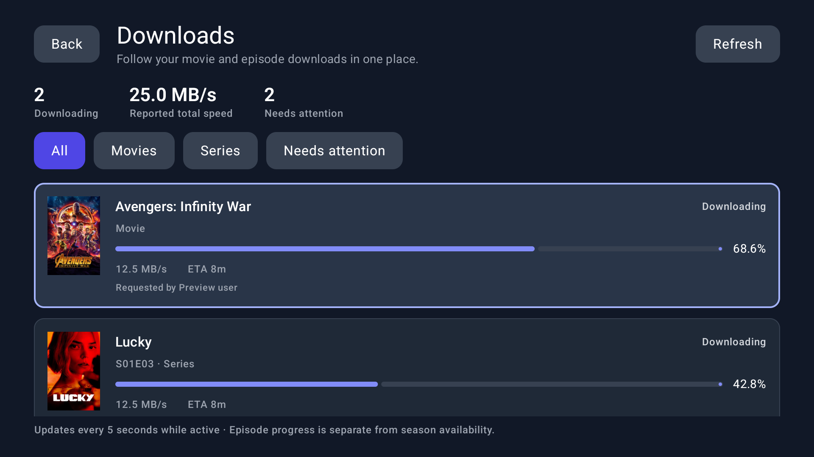

# Downloads screen

Open **Downloads** (the down-arrow between Settings and Series) in the top navigation.
Use Left/Right to choose a header action or filter, Down to reach the queue, and Enter
on a download to open its existing media details page. Back returns to the previous screen.

The screen follows processing requests visible to the configured Seerr account. Posters
and title translations come from the same media-details API used elsewhere in the app.

Preview uses synthetic downloads and a synthetic requester name, with existing media posters.

## Server requirements and limits

Enable download tracking on the relevant Radarr/Sonarr services in Seerr. The TV app reads
`GET /api/v1/request?filter=processing&take=100&skip=…&sort=modified` using its existing
authenticated client. It does not contact Radarr, Sonarr, or a torrent client directly.
Request permissions remain enforced by Seerr. There are no new credentials or settings.

Standard queue fields provide percentage (`size` and `sizeLeft`), status, and ETA
(`estimatedCompletionTime`). Exact download speed and precise paused/stalled states are
not supplied by every server version. Optional `downloadSpeed`, `liveStatus`,
`liveUpdatedAt`, and `etaSeconds` fields are accepted when available; speeds expire after
15 seconds. Missing speed/ETA is displayed as unavailable, never inferred from file size.
The server's own queue refresh interval limits how quickly changes reach the screen.

Only processing requests are scanned, not every historical request or every torrent in
Radarr/Sonarr. Downloads without an associated visible processing request, including
some quality upgrades, may not appear. An empty list does not prove that tracking services
are healthy: the standard request API does not report tracker availability.

Each row represents a download, not completion of a series or season. Shared episode
packs count their bytes/speed once and list known episodes in requested seasons. TV entries
without episode scope are omitted. Imported or removed entries disappear on the next
successful queue snapshot; existing media availability behavior is unchanged.

## Polling and errors

Polling runs every 5 seconds with entries, or 15 seconds with an empty queue, only while
the screen's navigation entry is RESUMED. Leaving the page or backgrounding cancels polling.
Requests are serialized and do not reuse the home carousel's pagination state. Up to 100
processing requests are fetched per page with a 20-page safety bound. A failed page retains
the previous snapshot and displays a refresh error, instead of publishing a partial list.
Metadata is cached per active title, fetched at most four titles concurrently, and failed
metadata lookups retry no sooner than one minute later.

D-pad focus uses the app's custom controller. Rows use stable identity derived from media,
service instance, quality, and download ID; titles and filenames are not used for matching.
If the selected row disappears, focus returns to the selected filter. Raw download IDs are
not displayed or logged by this feature.

## Validation

Run `:tv:assemblePlayAppDebug`, `:tv:testPlayAppDebugUnitTest`, and `:tv:lintPlayAppDebug`.
Repository tests cover stock API decoding, independent pagination, partial-page errors,
quality/instance separation, shared episode packs, unknown scope, removed queue entries,
progress clamping, stale speed/ETA, and remote focus transitions.

For device verification, configure a test account/server through normal application setup.
Use synthetic queue fixtures for downloading, paused, stalled, completed-before-import,
and failed entries when no real downloads are active. Verify filters, scrolling, opening
media details and returning, removal of the focused row, and request counts after Back/Home.
Never bundle an account configuration or credentials in the APK or contribution.
